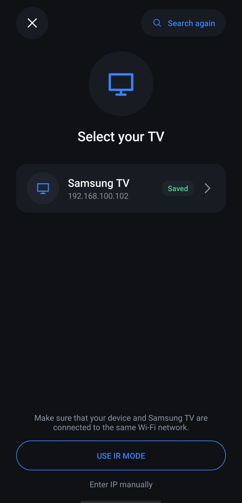
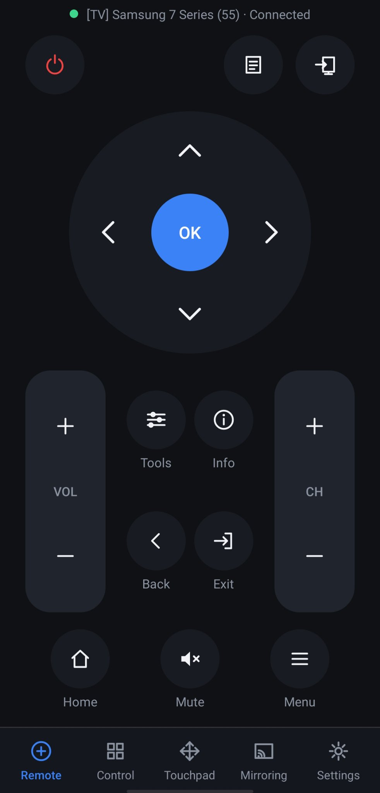
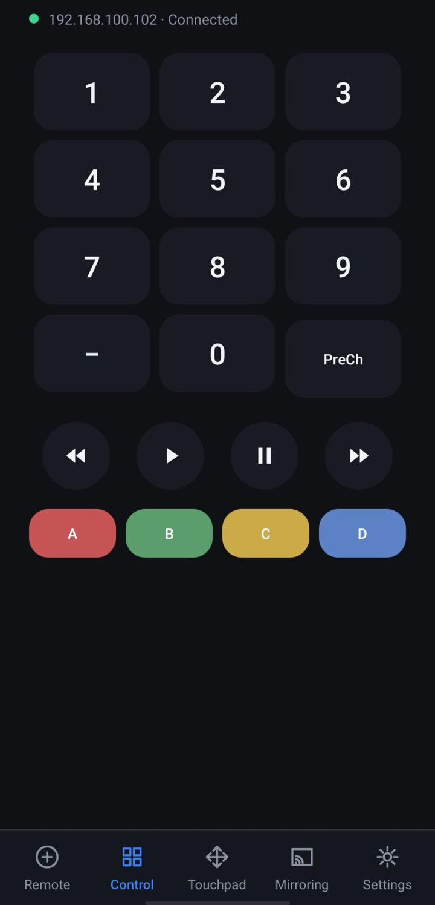
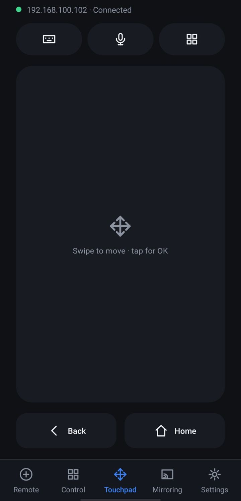
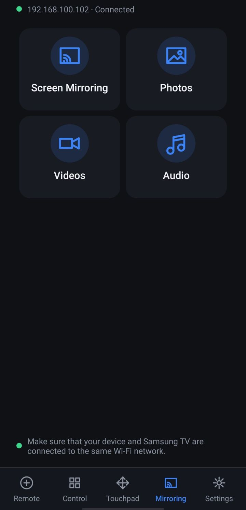
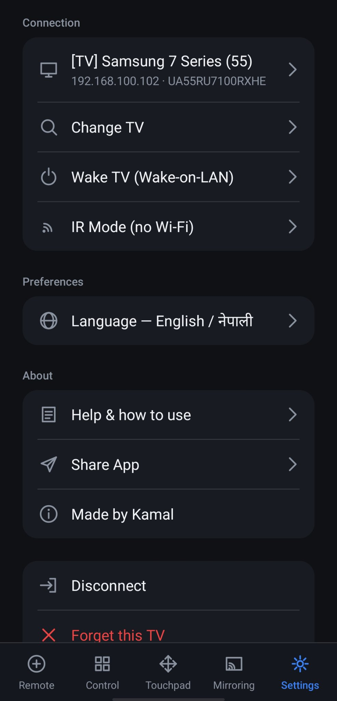

# Samsung TV Remote App

A native Android remote for Samsung TVs that talks to the TV directly over
the home network. No bridge, no PC, no server. Discovery is SSDP; control
uses the Samsung pairing protocol on `wss://<tv>:8002` (2016 and newer TVs).
Every protocol payload was verified against a decompiled reference app and
exercised on a real Samsung TV.

## Screenshots

| Search | Remote | Control |
| --- | --- | --- |
|  |  |  |

| Touchpad | Mirroring | Settings |
| --- | --- | --- |
|  |  |  |

## Features

- Five tabs: Remote, Control, Touchpad, Mirroring, Settings
- D-pad with press-and-hold, volume and channel rockers, number pad, media
  keys and color buttons
- Text input from the phone keyboard, plus voice typing
- The TV's real app list with real icons (YouTube, Netflix and the rest)
- IR blaster mode with Samsung BN59 codes for TVs off the network
- Screen mirroring and media casting through a built-in MJPEG server
- Wake-on-LAN, English and Nepali UI, in-app Help with screenshots
- Live connection status, and the pairing token is saved so reconnecting
  after the first approval is instant

## Install

Copy the APK to the phone and open it (allow "install from this source"
when Android asks). First run: pick your TV from the search list (phone and
TV on the same Wi-Fi) and accept the allow prompt on the TV. 

Requires a 2016+ Samsung TV (the :8002 protocol) and Android 8+ (minSdk 26).

## Building

**Gradle (the standard way).** Open this folder in Android Studio and run
the `app` module, or use Gradle from the command line. The Gradle wrapper
JAR is committed (its SHA-256 matches the checksum Gradle publishes for
8.9); if the `gradlew` scripts are missing, Android Studio generates them
on import, or run `gradle wrapper --gradle-version 8.9` once with any
Gradle install. Toolchain: Android Gradle Plugin 8.7.3, Kotlin 2.0.21,
compileSdk 35. Dependencies are deliberately few: Kotlin coroutines and
OkHttp.

**Tests.** JUnit 5 unit tests live in `tvcore/src/test` and `app/src/test`
(Range parsing, MAC validation, TV address validation, English/Nepali string parity):
`gradle test`. The GitHub Actions workflow in `.github/workflows/ci.yml`
runs the unit tests, lint, and a debug build on every push and pull
request.

**build.sh (no Gradle).** The repo also carries a small explicit pipeline:

```bash
./build.sh   # → dist/TV-Remote.apk
```

kotlinc → d8 → aapt2 → zipalign → apksigner, one visible command per step.
It is handy when you want to see exactly what an APK build does, or on a
machine where a full Gradle setup is overkill: there is no build daemon, no
generated code, and the whole dependency list is a handful of JARs named at
the top of the script. It needs JDK 21 and Android SDK 35 (build-tools
35.0.0); tool locations are overridable through `JAVA_HOME`, `ANDROID_HOME`,
`M2` and `KEYSTORE`.

Signing: build.sh and Gradle debug builds are signed with the standard
Android debug key. A Gradle release build is unsigned unless you create
`app/keystore.properties` pointing at your own keystore (see
`app/build.gradle.kts`). For anything beyond personal use, sign with a
personal keystore and keep using it: Android only accepts updates signed
by the same key.

## Project structure

```
app/          the application: UI, IR blaster, mirroring service
tvcore/       the Samsung protocol library (discovery, pairing, keys, apps)
screenshots/  the screenshots above, from a real phone and a real TV
build.sh      the no-Gradle build pipeline
```

The UI is plain framework Views with layouts built in code: no AndroidX, no
Compose, no XML layouts, no generated R class. `tvcore` is an Android
library with no UI dependencies; it does use Android's Base64 and org.json,
so it is reusable in other Android apps rather than as a pure JVM library.

## Permissions and privacy

- Network permissions (internet, Wi-Fi state, multicast) are used only to
  find and talk to your TV on your own network. Nothing leaves the LAN.
- TVs and their browsers speak plain HTTP on the LAN (UPnP descriptions,
  the mirror stream), so the app permits cleartext HTTP through its
  network security config. The control connection to the TV itself is
  encrypted (wss) and pinned to the TV's certificate.
- The pairing token and the TV's certificate fingerprint are stored only on
  the phone, and Android backups are disabled for this app. The first
  connection pins the TV's certificate; if the TV's certificate ever
  changes, the app refuses to connect until you choose to trust the new
  one.
- Screen mirroring runs a small HTTP server on port 8080, bound to the
  phone's Wi-Fi address, so the TV's browser can open the stream. Every
  address it serves includes a random per-session token, and requests
  without it are refused. The token travels inside the address the TV
  opens, so anyone who can see that address can use it until the cast
  stops; treat it like a session password. The server stops with the
  cast.
- IR mode uses the phone's infrared blaster and needs no network at all.

## Troubleshooting

- **TV not found:** the TV must be on (not in deep standby) and on the same
  Wi-Fi as the phone. Some routers block multicast between bands; try the
  same band for both, or use Enter IP manually.
- **"Certificate changed" error:** the TV was replaced, reset, or its
  certificate rotated. If the change is expected, tap Trust new
  certificate to pair again.
- **Mirroring will not start, port busy:** another app is using port 8080.
  The mirror screen shows this error; close that app and try again.
- **TV asks for approval every time:** the saved pairing token was cleared
  (for example after trusting a new certificate). Accept the prompt once
  and it is saved again.

## Honest limits

- Pre-2016 (legacy socket) TVs were analysed but are not implemented.
- Screen mirroring is MJPEG, so it is smooth enough for showing content,
  not for gaming.

## License

MIT, see [LICENSE](LICENSE).
